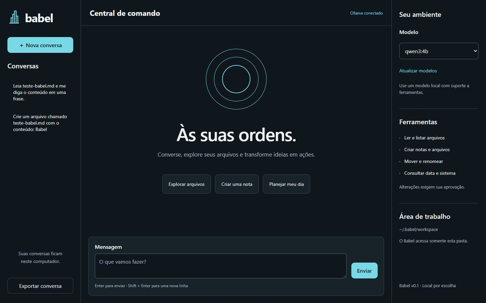

<p align="center"></p>
<h1 align="center">Babel</h1>
<p align="center"><strong>Seu computador. Sua inteligência. Suas decisões.</strong></p>
<p align="center">Um agente pessoal de IA local, inspirado na ideia de ter seu próprio assistente de ficção científica.</p>
<p align="center">
  <a href="https://github.com/ogbraiaaa/babel/actions/workflows/ci.yml"></a>
  
  <a href="LICENSE"></a>
</p>



## Um assistente que também age

O Babel conecta um modelo executado no **Ollama** a ferramentas reais. Ele consulta arquivos, prepara notas e propõe reorganizar sua pasta. Antes de criar ou mover um arquivo, mostra a ação e espera sua aprovação no painel.

Esta é uma **primeira versão funcional**, não uma reprodução das capacidades fictícias do JARVIS. O projeto tem identidade própria e não possui vínculo com Marvel ou Disney.

- **IA local:** Ollama em `127.0.0.1:11434`, sem chave de API.
- **Ferramentas reais:** listar e ler arquivos, criar notas, mover arquivos e consultar data e sistema.
- **Você decide:** aprovação individual e de uso único para cada alteração.
- **Histórico persistente:** conversas e ações pendentes salvas em SQLite.
- **Área de trabalho delimitada:** acesso apenas à pasta escolhida.
- **Painel em português:** interface responsiva, seleção de modelo e exportação em Markdown.
- **Instalação pequena:** Python + HTML/CSS/JavaScript, sem dependências externas de execução.

## Comece em poucos passos

Você precisa de **Python 3.11+**, **Git** e [Ollama](https://ollama.com/download). A memória necessária e a velocidade dependem do modelo e do computador.

### 1. Prepare o modelo

Abra o Ollama e baixe um modelo com suporte a ferramentas:

```bash
ollama pull qwen3:4b
```

Se o serviço não estiver ativo, execute `ollama serve` em outro terminal. O download precisa de internet; modelos locais já baixados podem funcionar offline. Não selecione modelos de nuvem. Para desativar recursos de nuvem do próprio Ollama, consulte sua [documentação oficial](https://docs.ollama.com/faq).

### 2. Baixe e execute

```bash
git clone https://github.com/ogbraiaaa/babel.git
cd babel
python -m babel_agent
```

O navegador abre em **http://127.0.0.1:8765**. Não é necessário instalar pacotes para executar diretamente do código.

Para instalar o comando `babel`, preferencialmente em um ambiente virtual:

```bash
python -m venv .venv
# Windows: .venv\Scripts\activate
# Linux/macOS: source .venv/bin/activate
python -m pip install .
babel
```

### 3. Dê a primeira missão

> Crie uma nota em notas/primeiro-projeto.md com um plano para aprender Python.

Revise o caminho e o conteúdo e clique em **Aprovar ação** ou **Recusar ação**. Só depois da aprovação o arquivo é criado.

Outros pedidos para experimentar:

```text
Liste os arquivos da minha área de trabalho.
Leia notas/primeiro-projeto.md e resuma os próximos passos.
Mova notas/primeiro-projeto.md para projetos/python.md.
Que dia é hoje e qual sistema operacional estou usando?
Me ajude a planejar meu dia. Pergunte primeiro quais são minhas prioridades.
```

## Configuração

```bash
python -m babel_agent --workspace "D:/BabelWorkspace"
python -m babel_agent --port 9000 --no-browser
python -m babel_agent --data-dir "D:/BabelData"
```

| Opção | Padrão | Função |
| --- | --- | --- |
| `--workspace` | `~/.babel/workspace` | Pasta acessível pelas ferramentas |
| `--data-dir` | `~/.babel` | Local do banco de conversas |
| `--port` | `8765` | Porta do painel local |
| `--no-browser` | Desativado | Inicia sem abrir o navegador |

`~` representa sua pasta de usuário. Coloque na área de trabalho apenas os arquivos que deseja disponibilizar ao agente. O histórico fica em `~/.babel/babel.sqlite3`; arquivos pessoais e conversas não fazem parte do repositório.

## Arquitetura

```text
Você → Painel local → Agente Python → Ollama → Modelo local
                           │
                           ├── Consulta → ferramenta → resultado ao modelo
                           ├── Alteração → sua aprovação → ferramenta
                           └── SQLite → histórico e ações pendentes
```

O modelo escolhe ferramentas por chamadas estruturadas da [API de chat do Ollama](https://docs.ollama.com/api/chat). O servidor valida argumentos e caminhos. Resultados retornam ao modelo para compor a resposta. Cada execução tem um limite de oito rodadas; cada alteração exige uma nova aprovação.

O frontend não usa CDN, fontes remotas, analytics nem serviços de IA externos. O servidor escuta somente em `127.0.0.1`, verifica Host/Origin e exige um token efêmero nas chamadas da interface. Não foi projetado para hospedagem pública ou acesso multiusuário.

```text
babel_agent/
  agent.py      # Ciclo do agente e persistência
  ollama.py     # Cliente HTTP local
  tools.py      # Ferramentas e limites de acesso
  server.py     # API e servidor do painel
  web/          # Interface sem build obrigatório
tests/          # Testes automatizados
```

## Limites da versão 0.1

- Ainda não escuta microfone, não tem palavra de ativação e não fala em voz alta.
- Não controla aplicativos, não executa terminal e não navega na internet.
- Leitura/criação: texto UTF-8 de até 64 KiB. Movimentação: arquivos de até 64 KiB; pastas não são movidas.
- Não sobrescreve arquivos existentes. Listagens retornam até 200 entradas.
- Respostas aparecem ao final da geração; streaming está planejado.
- Memória significa histórico da conversa, não aprendizado permanente nem busca entre conversas. Conversas longas podem exceder o contexto do modelo.
- Chamadas de ferramentas dependem do modelo. Revise as propostas; a IA pode errar.
- Banco e arquivos ficam sem criptografia adicional no disco. Não há isolamento contra programas maliciosos executados na mesma conta.
- Alterar arquivos e atualizar o banco não são uma transação única. Após uma interrupção, confira a pasta antes de repetir a ação.

## Desenvolvimento e testes

```bash
python -m unittest discover -s tests -v
```

Os testes cobrem aprovação, recusa, persistência, prevenção de repetição, limites de arquivos, bloqueio de caminhos externos e proteção HTTP. Usam modelos simulados e não exigem Ollama. O GitHub Actions executa a suíte no Windows e no Linux com Python 3.11 e 3.13.

Veja [CONTRIBUTING.md](CONTRIBUTING.md) para contribuir.

## Próximos passos

- [ ] Entrada de voz com transcrição local.
- [ ] Respostas por voz com síntese offline.
- [ ] Streaming e cancelamento de tarefas.
- [ ] Memória pesquisável com referências às fontes.
- [ ] Integrações com aplicativos e permissões específicas.
- [ ] Empacotamento desktop.

## Licença

[MIT](LICENSE). Criado por [Brayan Silva](https://github.com/ogbraiaaa).
